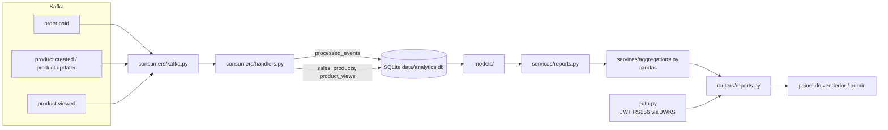

# marketplace-analytics

Serviço de relatórios do marketplace: consome os eventos de venda, catálogo e
visualização pelo Kafka, guarda uma cópia derivada em SQLite e responde
relatórios agregados com pandas para o painel do vendedor e para o admin.

[](LICENSE)

## Stack

- Python 3.13, FastAPI e uvicorn
- aiokafka (consumer do grupo `marketplace-analytics`)
- SQLite pela `sqlite3` da biblioteca padrão, migrations numeradas
- pandas para as agregações
- PyJWT + cryptography para validar o JWT RS256 contra o JWKS do `marketplace-auth`
- pydantic-settings para configuração, pytest + httpx para testes, ruff para lint e formato

## Como rodar

Pré-requisitos: Redpanda em `localhost:19092` e o `marketplace-auth` em
`localhost:3003` (ambos sobem pelo docker-compose do repositório `marketplace`).

### Local

```bash
python -m venv .venv
.venv/Scripts/activate          # Linux/macOS: source .venv/bin/activate
pip install -e ".[dev]"
cp .env.example .env
python -m app.main
```

O serviço sobe em `http://localhost:3005`, cria `data/analytics.db` e aplica
as migrations na primeira subida. Documentação interativa em `/docs`.

### Docker

```bash
docker build -t marketplace-analytics .
docker run --rm -p 3005:3005 \
  -e KAFKA_BROKERS=redpanda:9092 \
  -e AUTH_URL=http://auth:3003 \
  -v analytics-data:/app/data \
  marketplace-analytics
```

Variáveis de ambiente (todas com padrão em `.env.example`):

| Variável | Padrão | Uso |
|---|---|---|
| `PORT` | `3005` | porta HTTP |
| `KAFKA_BROKERS` | `localhost:19092` | lista de brokers |
| `AUTH_URL` | `http://localhost:3003` | base do JWKS (`/.well-known/jwks.json`) |
| `DB_PATH` | `data/analytics.db` | arquivo SQLite |
| `LOG_LEVEL` | `info` | nível do `logging` |

## Arquitetura



Fluxo em duas metades independentes: o consumer grava, as rotas leem. Cada
requisição abre a própria conexão SQLite (modo WAL), então leitura e escrita
não se bloqueiam.

```
app/
  main.py                 cria o FastAPI, roda migrations e inicia o consumer no lifespan
  config.py               Settings (pydantic-settings) e configuração do logging
  db.py                   conexão SQLite, lista de migrations, formato de data
  auth.py                 dependência require_role: valida o Bearer no JWKS e exige o perfil
  errors.py               DomainError(code, status) e os exception handlers do envelope
  envelope.py             ok() e fail(), o formato de resposta de todos os serviços
  schemas.py              modelos Pydantic da query string (datas, sellerId, groupBy, limit)
  dependencies.py         get_db (uma conexão por requisição) e get_report_service
  consumers/
    kafka.py              loop aiokafka com reconexão; commit só depois de gravar
    handlers.py           um método por tipo de evento, idempotência por eventId
  models/                 SQL puro, sem try/except: sales, products, views, processed_events
  services/
    aggregations.py       funções puras: DataFrame entra, lista pronta para o JSON sai
    reports.py            ReportService: regra de acesso por perfil e montagem dos DataFrames
  routers/
    reports.py            GET /reports/*
    health.py             GET /health
data/                     o .db fica aqui (ignorado pelo git)
tests/                    pytest, um arquivo por módulo
```

Tratamento de erro em três camadas: model faz I/O e deixa a exceção subir,
service lança `DomainError` com código e status, rota não tem try/except.
`errors.py` traduz `DomainError` para o status dele, validação do Pydantic para
422 e qualquer outra exceção para 500 genérico com a causa só no log.

## Rotas

Todas as rotas de relatório exigem `Authorization: Bearer <token>` com perfil
`seller` ou `admin`. Vendedor precisa informar `sellerId` igual ao próprio
`sub`; admin pode omitir (vê tudo) ou filtrar por qualquer vendedor.

| Rota | Parâmetros | Resposta |
|---|---|---|
| `GET /reports/sales` | `from`, `to`, `sellerId`, `groupBy=day\|week\|month` | série com `period`, `revenueCents`, `orders`, `itemsSold` |
| `GET /reports/sales.csv` | os mesmos | mesma série em `text/csv`, com `Content-Disposition: attachment` |
| `GET /reports/top-products` | `from`, `to`, `sellerId`, `limit` (1 a 100, padrão 10) | `byRevenue` e `byQuantity`, cada um com `productId`, `name`, `revenueCents`, `itemsSold` |
| `GET /reports/views` | `from`, `to`, `sellerId` | por produto: `views`, `orders`, `conversionRate` (pedidos / visualizações) |
| `GET /health` | | `sqlite` e `kafka` em `ok` ou `down`; 503 se algum estiver fora |

`from` e `to` em ISO 8601 (`2026-10-01` ou `2026-10-01T00:00:00Z`); sem fuso,
são lidos como UTC. Sem os dois, o padrão é os últimos 30 dias. `period` é o
primeiro dia do grupo (semana começa na segunda-feira).

Exemplo:

```bash
curl -H "Authorization: Bearer $TOKEN" \
  "http://localhost:3005/reports/sales?from=2026-10-01&to=2026-10-31&sellerId=usr_01J9X&groupBy=week"
```

```json
{
  "success": true,
  "message": null,
  "data": [
    { "period": "2026-10-05", "revenueCents": 39980, "orders": 1, "itemsSold": 2 }
  ]
}
```

Erros seguem `{ "success": false, "message": "...", "errors": [] }`: 401 sem
token ou token inválido, 403 vendedor consultando outro `sellerId`, 422
parâmetro inválido (com `errors[].field`), 404 rota inexistente.

## Eventos consumidos

| Tópico | O que o serviço faz |
|---|---|
| `order.paid` | uma linha em `sales` por item do pedido, com `sellerId` do item |
| `product.created` | insere em `products` |
| `product.updated` | atualiza nome, preço, categoria e vendedor; mantém `created_at` |
| `product.viewed` | insere em `product_views` (`userId` pode ser nulo) |

Todo envelope passa por `processed_events`: o `eventId` é gravado na mesma
transação dos dados, então repetição é ignorada e falha no meio desfaz a marca.
O offset no Kafka só é commitado depois dessa transação.

## Decisões

- **SQLite e não MySQL.** O dado aqui é derivado: só este serviço lê, ninguém
  mais escreve, e tudo pode ser reconstruído reprocessando os tópicos desde o
  início (basta apagar o `.db` e usar outro `group_id`). Um arquivo local com
  WAL atende sem servidor extra. O CONTRATOS já reserva `data/analytics.db`.
- **`sqlite3` da stdlib e não SQLAlchemy.** São quatro tabelas e meia dúzia de
  consultas. Um `db.py` de cem linhas com migrations em lista cobre tudo; o ORM
  traria uma dependência pesada para esconder SQL que cabe numa tela.
- **pandas e não SQL puro para agregar.** Agrupar por semana, ranquear por dois
  critérios e calcular conversão com produtos sem visualização fica legível em
  pandas e testável sem banco: `services/aggregations.py` recebe DataFrames e
  devolve listas. O SQL só filtra por período e vendedor.
- **aiokafka e não confluent-kafka.** É puro Python, instala sem compilar
  `librdkafka` e conversa com o loop asyncio do FastAPI no mesmo processo, o que
  deixa o serviço num container só.
- **Uma conexão SQLite por requisição.** Abrir custa menos de um milissegundo e
  evita dividir uma conexão entre as threads do FastAPI e o consumer. O consumer
  tem a dele.
- **Conversão zero quando não há visualização.** Produto vendido sem
  `product.viewed` registrado devolve `conversionRate: 0.0`, não erro nem
  `null`, para o painel desenhar sem tratar caso especial.
- **Validação de intervalo como erro de domínio.** `from >= to` lança
  `DomainError('report.invalid_range', 422)` de dentro do modelo Pydantic, para
  a mensagem sair em pt-BR como as outras.

### O que entra depois

- Recomendação de produtos a partir das avaliações: embeddings das reviews com
  um modelo da Hugging Face (`sentence-transformers`) e similaridade por
  vendedor, expostos em `GET /recommendations`. Depende de um evento
  `review.created` que ainda não existe no CONTRATOS.
- `product.deleted` para marcar o produto como inativo nos rankings.
- Cache curto das séries mais pedidas quando o volume justificar.

## Testes

```bash
pytest
ruff check .
ruff format --check .
```

56 testes: agregações com DataFrames fixos (dia, semana, mês, ranking,
conversão sem divisão por zero), handlers com SQLite em memória
(idempotência, upsert, rollback), rotas com `TestClient` e a dependência de
auth sobrescrita (403 para vendedor em outro `sellerId`, 422 de validação,
CSV), validação de JWT com chave RSA gerada no teste e `/health`.

## Licença

[MIT](LICENSE)
